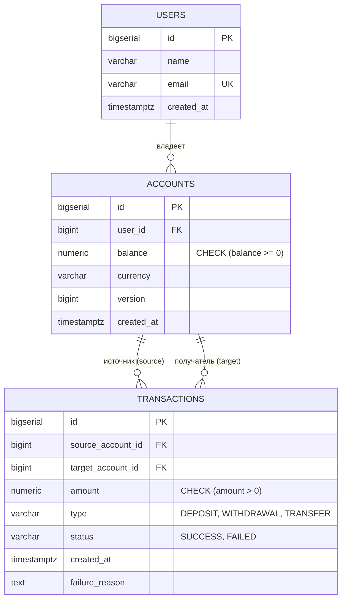
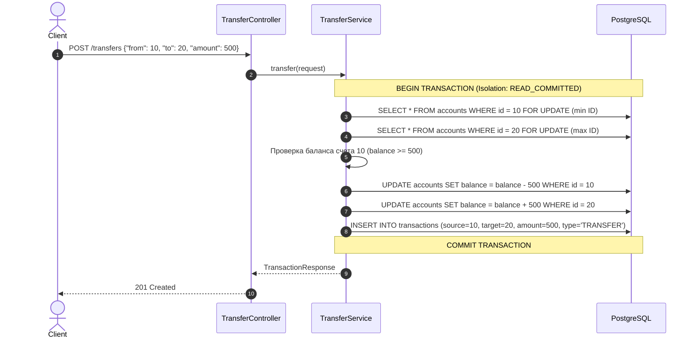

# 🏦 Banking Backend API

Надежный банковский сервис денежных переводов и управления счетами на стеке **Java 21 + Spring Boot 3 + PostgreSQL + Flyway + Testcontainers + Docker Compose**.

---

## 📌 Оглавление
1. [Ключевые возможности](#-ключевые-возможности)
2. [Технологический стек](#-технологический-стек)
3. [Архитектура и модель данных](#-архитектура-и-модель-данных)
4. [Атомарность переводов и защита от Deadlock](#-атомарность-переводов-и-защита-от-deadlock)
5. [Спецификация REST API и cURL примеры](#-спецификация-rest-api-и-curl-примеры)
6. [Запуск проекта (Docker Compose & Gradle)](#-запуск-проекта)
7. [Тестирование](#-тестирование)
8. [Переменные окружения](#-переменные-окружения)
9. [Инициализация Git](#-инициализация-git)

---

## 📌 Ключевые возможности

- **Управление счетами**:
  - Создание счетов для пользователей (`POST /accounts`).
  - Просмотр актуального баланса (`GET /accounts/{id}`).
  - Пополнение счета (`POST /accounts/{id}/deposit`).
  - Снятие наличных со счета с валидацией баланса (`POST /accounts/{id}/withdraw`).
- **Атомарный перевод средств (`POST /transfers`) — Главная фича**:
  - Строгая изоляция и атомарность в рамках одной транзакции базы данных (`@Transactional`).
  - **Deadlock Prevention (Защита от взаимных блокировок)**: блокировка счетов (`PESSIMISTIC_WRITE`) осуществляется в каноническом порядке по возрастанию их идентификаторов (`min(from, to)` -> `max(from, to)`).
  - Проверка инвариантов: достаточность средств, валютное соответствие, положительная сумма (`> 0`), запрет перевода самому себе (`from != to`).
- **Аудит и история транзакций**:
  - Полный лог всех операций (`DEPOSIT`, `WITHDRAWAL`, `TRANSFER`) с типами, суммами и метками времени (`GET /accounts/{id}/transactions`).
- **Готовая инфраструктура**:
  - Автоматические миграции схемы БД через Flyway.
  - Multi-stage Dockerfile и Docker Compose для моментального запуска приложения и PostgreSQL.
  - Healthcheck через Spring Boot Actuator (`GET /actuator/health`).

---

## 🛠 Технологический стек

- **Язык**: Java 21 (Records, Switch pattern matching, Toolchains)
- **Фреймворк**: Spring Boot 3.3.4
  - `spring-boot-starter-web` (REST API)
  - `spring-boot-starter-data-jpa` (Hibernate 6)
  - `spring-boot-starter-validation` (Jakarta Validation)
  - `spring-boot-starter-actuator` (Мониторинг здоровья)
- **СУБД**: PostgreSQL 16
- **Миграции**: Flyway (`flyway-core`, `flyway-database-postgresql`)
- **Сборщик**: Gradle 8.14 (обертка `gradlew` / `gradlew.bat`)
- **Тестирование**:
  - JUnit 5 & Mockito (Unit-тесты)
  - Testcontainers (Интеграционные тесты с реальным контейнером PostgreSQL)
  - Многопоточные стресс-тесты на проверку отсутствия взаимных блокировок (Deadlocks)
- **Контейнеризация**: Docker (Multi-stage сборка) & Docker Compose

---

## 🏛 Архитектура и модель данных

### ER-диаграмма сущностей:



### Схема таблиц:

1. **`users`** — пользователи банка:
   - `id`: первичный ключ (`BIGSERIAL`).
   - `name`: имя клиента (`VARCHAR(255) NOT NULL`).
   - `email`: уникальный email (`VARCHAR(255) UNIQUE NOT NULL`).
   - `created_at`: дата регистрации.

2. **`accounts`** — банковские счета:
   - `id`: номер счета (`BIGSERIAL`).
   - `user_id`: внешний ключ на владельца (`BIGINT NOT NULL REFERENCES users(id)`).
   - `balance`: баланс с точностью до 4 знаков (`NUMERIC(19, 4) NOT NULL`, ограничение `CHECK (balance >= 0)`).
   - `currency`: валюта счета (по умолчанию `'RUB'`).
   - `version`: версионирование для оптимистических проверок.
   - `created_at`: дата открытия счета.

3. **`transactions`** — история операций:
   - `id`: идентификатор транзакции (`BIGSERIAL`).
   - `source_account_id`: счет списания (`BIGINT NULL REFERENCES accounts(id)`).
   - `target_account_id`: счет зачисления (`BIGINT NULL REFERENCES accounts(id)`).
   - `amount`: сумма операции (`NUMERIC(19, 4) NOT NULL`, ограничение `CHECK (amount > 0)`).
   - `type`: тип операции (`DEPOSIT`, `WITHDRAWAL`, `TRANSFER`).
   - `status`: статус (`SUCCESS`, `FAILED`).
   - `created_at`: метка времени проведения.
   - `failure_reason`: причина ошибки (при сбое).

---

## 🔒 Атомарность переводов и защита от Deadlock

### Алгоритм атомарного перевода:



### Защита от дедлоков (Deadlock Prevention):
- **Проблема**: Если Поток 1 переводит средства со счета 10 на 20 (блокирует 10, затем 20), а Поток 2 в это же мгновение переводит со счета 20 на 10 (блокирует 20, затем 10) — в базе возникает циклический взаимный тупик (**Deadlock**).
- **Решение**: Ресурсная иерархия по Дейкстре. В `TransferService` порядок захвата блокировок (`PESSIMISTIC_WRITE` / `SELECT ... FOR UPDATE`) строго детерминирован по возрастанию ID:
  ```java
  Long firstId = Math.min(request.from(), request.to());
  Long secondId = Math.max(request.from(), request.to());

  Account first = accountRepository.findByIdWithLock(firstId)
          .orElseThrow(() -> new AccountNotFoundException(firstId));
  Account second = accountRepository.findByIdWithLock(secondId)
          .orElseThrow(() -> new AccountNotFoundException(secondId));
  ```
  Это математически устраняет условия возникновения цикла ожидания ресурсов. Корректность протестирована в многопоточном интеграционном тесте `TransferConcurrencyIntegrationTest`.

---

## 📡 Спецификация REST API и cURL примеры

В миграции `V2__insert_sample_data.sql` уже предзаполнены:
- **Пользователь 1** (`Alice Smith`) со счетом **`id: 10`** (баланс: `1000.00 RUB`).
- **Пользователь 2** (`Bob Johnson`) со счетом **`id: 20`** (баланс: `200.00 RUB`).

### 1. Создать счет
- **URL**: `POST /accounts`
- **Request**:
```bash
curl -X POST http://localhost:8080/accounts \
  -H "Content-Type: application/json" \
  -d '{
    "userId": 1,
    "initialBalance": 1000.00,
    "currency": "RUB"
  }'
```
- **Response** `201 Created`:
```json
{
  "id": 10,
  "userId": 1,
  "balance": 1000.0000,
  "currency": "RUB",
  "createdAt": "2026-09-30T16:20:00Z"
}
```

---

### 2. Получить данные счета
- **URL**: `GET /accounts/{id}`
- **Request**:
```bash
curl -X GET http://localhost:8080/accounts/10
```
- **Response** `200 OK`:
```json
{
  "id": 10,
  "userId": 1,
  "balance": 1000.0000,
  "currency": "RUB",
  "createdAt": "2026-09-30T16:20:00Z"
}
```

---

### 3. Пополнить счет (Deposit)
- **URL**: `POST /accounts/{id}/deposit`
- **Request**:
```bash
curl -X POST http://localhost:8080/accounts/10/deposit \
  -H "Content-Type: application/json" \
  -d '{
    "amount": 250.00
  }'
```
- **Response** `200 OK`:
```json
{
  "id": 10,
  "userId": 1,
  "balance": 1250.0000,
  "currency": "RUB",
  "createdAt": "2026-09-30T16:20:00Z"
}
```

---

### 4. Снять средства со счета (Withdraw)
- **URL**: `POST /accounts/{id}/withdraw`
- **Request**:
```bash
curl -X POST http://localhost:8080/accounts/10/withdraw \
  -H "Content-Type: application/json" \
  -d '{
    "amount": 100.00
  }'
```
- **Response** `200 OK`:
```json
{
  "id": 10,
  "userId": 1,
  "balance": 1150.0000,
  "currency": "RUB",
  "createdAt": "2026-09-30T16:20:00Z"
}
```
*При нехватке средств возвращается код `422 Unprocessable Entity`.*

---

### 5. Атомарный перевод средств (Transfer) — Главная фича!
- **URL**: `POST /transfers`
- **Опциональный заголовок** `Idempotency-Key` принимает непустой ключ длиной до 255 символов. Для каждого нового перевода используйте новый ключ, например UUID. При повторе запроса после таймаута отправьте тот же ключ и те же реквизиты.
- **Request**:
```bash
curl -X POST http://localhost:8080/transfers \
  -H "Content-Type: application/json" \
  -H "Idempotency-Key: 6e0d823d-7c89-43e4-8927-c2d466ec036b" \
  -d '{
    "from": 10,
    "to": 20,
    "amount": 500
  }'
```
- **Response** `201 Created`:
```json
{
  "id": 1,
  "sourceAccountId": 10,
  "targetAccountId": 20,
  "amount": 500.0000,
  "type": "TRANSFER",
  "status": "SUCCESS",
  "createdAt": "2026-09-30T16:22:00Z",
  "failureReason": null
}
```

Повторите команду с тем же ключом: сервис вернёт `201 Created` и тот же перевод, в том числе при параллельных запросах. Изменение суммы или любого из счетов при том же ключе вернёт `409 Conflict`. Если перевод завершится ошибкой, резервирование ключа откатится вместе с транзакцией. Без заголовка каждый запрос создаёт отдельный перевод при успешном выполнении.

---

### 6. История транзакций счета
- **URL**: `GET /accounts/{id}/transactions`
- **Request**:
```bash
curl -X GET http://localhost:8080/accounts/10/transactions
```
- **Response** `200 OK`:
```json
[
  {
    "id": 1,
    "sourceAccountId": 10,
    "targetAccountId": 20,
    "amount": 500.0000,
    "type": "TRANSFER",
    "status": "SUCCESS",
    "createdAt": "2026-09-30T16:22:00Z",
    "failureReason": null
  }
]
```

---

### 7. Health Check
- **URL**: `GET /actuator/health`
- **Request**:
```bash
curl -X GET http://localhost:8080/actuator/health
```
- **Response** `200 OK`:
```json
{
  "status": "UP"
}
```

---

## 🚀 Запуск проекта

### Вариант 1. Запуск через Docker Compose (Рекомендуемый)

Собрать и запустить приложение вместе с PostgreSQL одной командой:
```bash
docker compose up --build
```
- Сервис доступен: `http://localhost:8080`
- PostgreSQL доступен на хосте: порт `5433` (не конфликтует с существующим локальным 5432).

Остановить контейнеры:
```bash
docker compose down
```

---

### Вариант 2. Локальный запуск через Gradle Wrapper

1. Запустите PostgreSQL (например, через Docker):
   ```bash
   docker run --name bank_db -e POSTGRES_DB=bank_db -e POSTGRES_USER=postgres -e POSTGRES_PASSWORD=postgres -p 5432:5432 -d postgres:16-alpine
   ```
2. Запустите Spring Boot приложение:
   - Linux / macOS:
     ```bash
     ./gradlew bootRun
     ```
   - Windows PowerShell / CMD:
     ```cmd
     gradlew.bat bootRun
     ```

---

## 🧪 Тестирование

Набор тестов включает **31 автоматический тест**:

1. **Unit-тесты (JUnit 5 & Mockito)**:
   - `AccountTest` — проверка инвариантов бизнес-логики счета (депозит, списание, отрицательные суммы, недостаточность средств).
   - `AccountServiceTest` — изоляция сервисного слоя счетов с моками репозиториев.
   - `TransferServiceTest` — изоляция сервиса переводов, валидация порядка блокировок и обработки граничных случаев.
2. **Интеграционные тесты (Testcontainers + реальный PostgreSQL)**:
   - `AccountControllerIntegrationTest` — сквозные E2E тесты всех эндпоинтов REST API через `TestRestTemplate`.
   - `TransferConcurrencyIntegrationTest` — параллельный стресс-тест в 8 потоках с 20 одновременными встречными переводами между счетами (проверка отсутствия дедлоков и строгого сохранения суммарного баланса).
   - `TransferIdempotencyIntegrationTest` — проверка одного списания при параллельном повторе, ответа `409` при изменении суммы и отката ключа после ошибки.

Запуск тестов:
```cmd
gradlew.bat test
```
*(Testcontainers автоматически поднимает изолированный контейнер PostgreSQL и прогоняет миграции Flyway).*

GitHub Actions собирает проект и запускает все тесты при пуше в `main` и в pull request с целевой веткой `main`. HTML-отчёт доступен в артефакте `test-report` на странице запуска, в том числе при падении тестов.

---

## ⚙ Переменные окружения

| Переменная | По умолчанию | Описание |
|---|---|---|
| `DB_URL` | `jdbc:postgresql://localhost:5432/bank_db` | JDBC URL базы данных |
| `DB_USERNAME` | `postgres` | Пользователь БД |
| `DB_PASSWORD` | `postgres` | Пароль БД |
| `DB_PORT` | `5433` | Внешний порт PostgreSQL в Docker Compose |
| `SERVER_PORT` | `8080` | Порт Spring Boot приложения |

---
